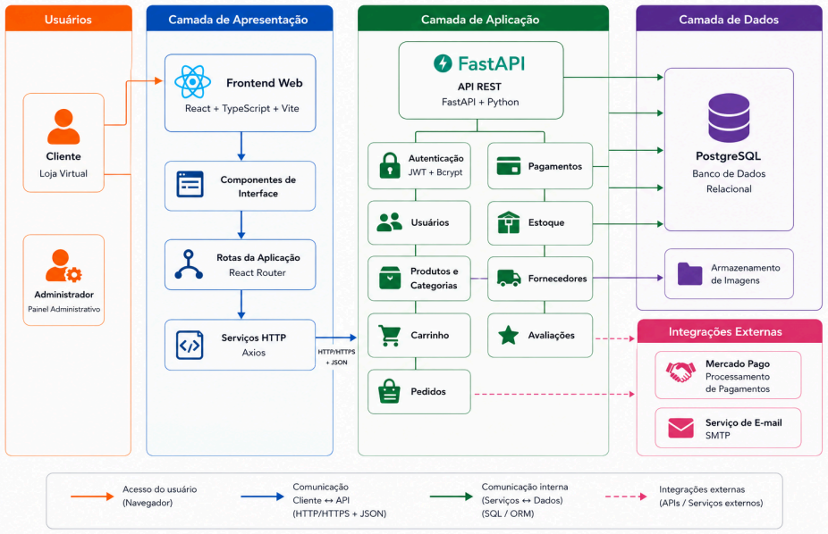
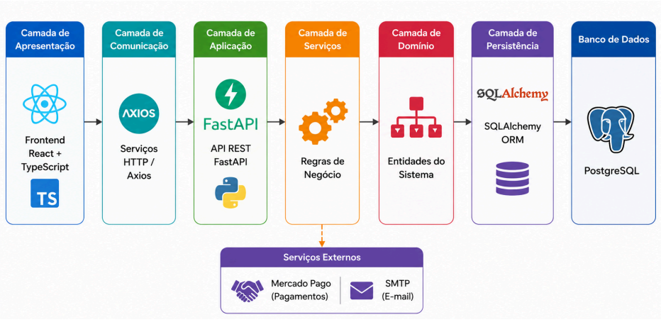
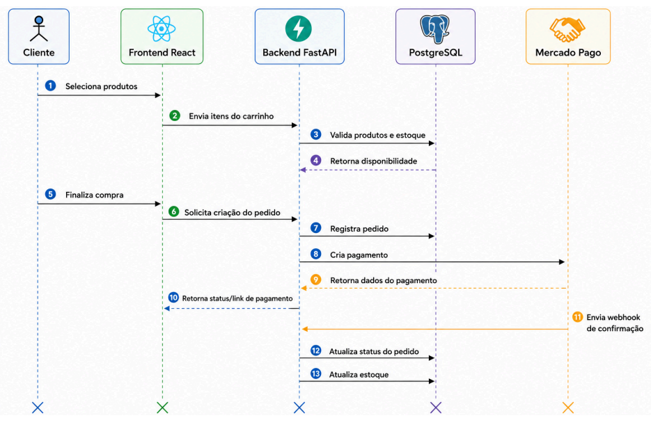
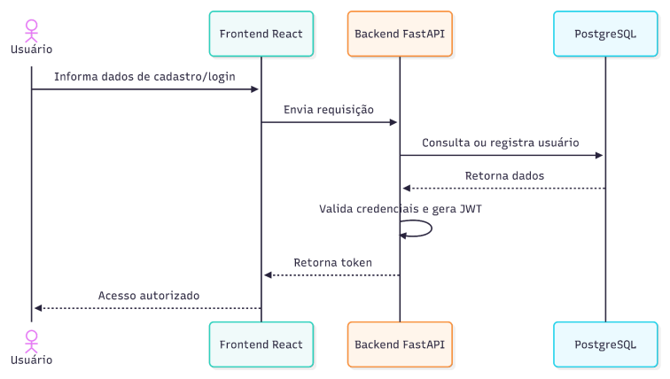
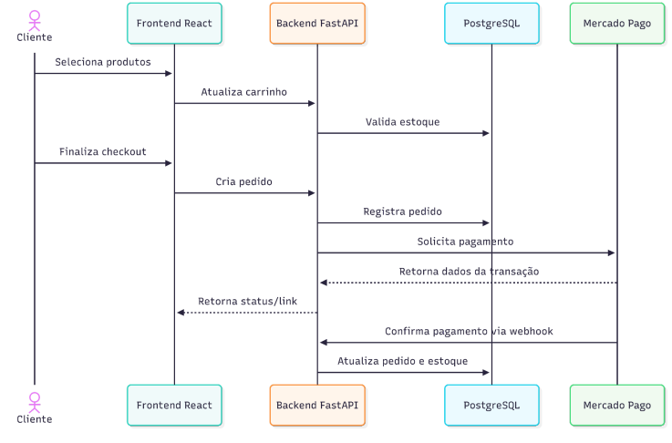
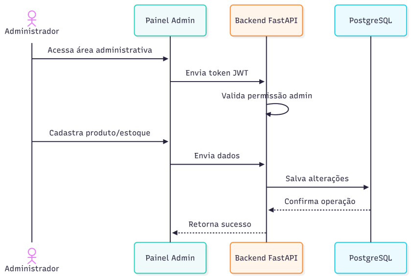

# Arquitetura do Sistema

**Última atualização:** 22 de novembro de 2026

A plataforma Toque de Mulher utiliza uma arquitetura desacoplada entre frontend, backend, banco de dados e integrações externas.

Essa separação busca facilitar a manutenção, a evolução da aplicação, a reutilização de componentes e a distribuição das responsabilidades entre os módulos do sistema.

A arquitetura foi atualizada ao longo do desenvolvimento, incorporando integrações de catálogo, pagamentos, envio, armazenamento de arquivos e melhorias de segurança.

## Visão geral da arquitetura

A arquitetura lógica apresenta a comunicação entre os principais usuários, a interface da aplicação, os serviços do backend, a camada de dados e os serviços externos utilizados pelo sistema.

Os principais componentes da arquitetura são:

- cliente da loja virtual;
- administrador;
- frontend web;
- componentes de interface;
- rotas da aplicação;
- serviços HTTP;
- API FastAPI;
- autenticação e autorização;
- usuários e perfis;
- produtos e categorias;
- catálogo integrado à API;
- carrinho e checkout;
- pedidos e pagamentos;
- estoque;
- fornecedores;
- endereços e frete;
- PostgreSQL;
- Supabase Storage;
- AbacatePay;
- serviços de envio;
- serviço de e-mail.

A comunicação entre esses componentes permite que a interface apresente informações obtidas da API e execute operações de negócio por meio do backend.

## Camadas da aplicação

A aplicação foi organizada em camadas para separar responsabilidades e reduzir o acoplamento entre os componentes.

| Camada | Tecnologia ou componente | Responsabilidade |
|---|---|---|
| Apresentação | React e TypeScript | Exibir a interface e receber as interações do usuário |
| Comunicação | Axios | Realizar requisições HTTP entre frontend e backend |
| Aplicação | FastAPI | Receber requisições e disponibilizar endpoints |
| Serviços | Regras de negócio | Processar operações, integrações e validações |
| Domínio | Entidades do sistema | Representar os objetos e conceitos da aplicação |
| Persistência | SQLAlchemy e/ou SQLModel | Realizar o mapeamento entre objetos e tabelas |
| Banco de dados | PostgreSQL | Armazenar informações persistentes |
| Armazenamento | Supabase Storage | Armazenar arquivos associados às funcionalidades implementadas |
| Serviços externos | AbacatePay, serviços de envio e e-mail | Processar pagamentos, operações de frete e comunicações |

## Frontend

O frontend é responsável pela interação entre os usuários e a plataforma.

A aplicação utiliza:

- React;
- TypeScript;
- Vite;
- React Router;
- Axios;
- componentes reutilizáveis;
- serviços HTTP centralizados;
- páginas públicas;
- área administrativa;
- controle de autenticação;
- gerenciamento de estados e dados da interface.

Entre suas principais responsabilidades estão:

- apresentar o catálogo;
- consultar produtos por meio da API;
- receber dados dos formulários;
- manter a navegação;
- gerenciar o carrinho;
- iniciar o checkout;
- apresentar informações de endereço e envio;
- enviar requisições ao backend;
- exibir mensagens de sucesso, carregamento e erro;
- controlar a navegação para páginas protegidas.

### Integração do catálogo

O frontend passou a utilizar uma integração específica com a API de catálogo.

Essa organização permite centralizar o acesso aos dados dos produtos e melhorar o tratamento dos estados de carregamento e erro.

As páginas de categorias, busca, produtos e favoritos também receberam melhorias relacionadas à apresentação das informações.

A interface passou a incorporar validações para impedir a seleção de produtos sem estoque disponível.

### Carrinho e checkout

O frontend gerencia a seleção dos produtos, suas quantidades e as etapas visuais da compra.

O fluxo recebeu melhorias de responsividade, tratamento das quantidades e aproveitamento do CEP informado pelo usuário.

A integração de pagamento passou a contemplar o AbacatePay, com a comunicação realizada por meio dos serviços da aplicação.

### Autenticação e perfil

O frontend utiliza access token para autenticação.

O fluxo anterior de refresh token foi removido durante a revisão técnica de setembro de 2026.

Posteriormente, foram realizados aprimoramentos relacionados à confirmação de e-mail, recuperação de senha e gerenciamento de sessões.

A proteção de navegação no frontend complementa, mas não substitui, as verificações de autorização realizadas pelo backend.

## Backend

O backend é responsável pelo processamento das requisições, pela aplicação das regras de negócio e pela comunicação com o banco de dados e serviços externos.

A API utiliza Python e FastAPI.

As funcionalidades contemplam:

- autenticação;
- usuários;
- endereços;
- produtos e categorias;
- catálogo;
- fornecedores;
- estoque;
- pedidos;
- pagamentos;
- checkout;
- integração de frete e envio;
- upload de arquivos;
- associação entre fornecedores e produtos;
- serviço de contato.

### Organização dos serviços

A arquitetura utiliza serviços para concentrar regras de negócio e integrações.

Entre as áreas que receberam atualizações estão:

- catálogo e consulta de produtos;
- checkout e validação de compras;
- pagamentos com AbacatePay;
- movimentações de estoque;
- operações de envio;
- autenticação e recuperação de acesso;
- armazenamento de avatares.

A organização em serviços busca reduzir o acoplamento entre endpoints e regras de negócio.

### Revisão da estrutura

Em setembro de 2026, foram removidas rotas experimentais e legadas que não integravam a API ativa.

Também foram eliminadas dependências e estruturas sem utilização identificada.

As atualizações posteriores incluíram melhorias nas integrações, no tratamento de erros e na infraestrutura de testes.

## Banco de dados

O PostgreSQL é utilizado para armazenar as informações persistentes da plataforma.

Entre os principais dados estão:

- usuários;
- endereços;
- produtos;
- categorias;
- pedidos;
- itens dos pedidos;
- pagamentos;
- estoque;
- fornecedores;
- relacionamentos entre fornecedores e produtos.

A comunicação com o banco utiliza mecanismos de mapeamento objeto-relacional, como SQLAlchemy ou SQLModel, conforme os módulos da aplicação.

### Integridade e consistência

A arquitetura incorpora validações para evitar registros inválidos e inconsistências.

Entre as regras estão:

- prevenção de quantidades negativas;
- prevenção de preços negativos;
- controle de endereços padrão;
- controle de métodos de pagamento padrão;
- validação de valores monetários;
- proteção da consistência das movimentações de estoque.

As atualizações de novembro também incluíram correções relacionadas ao bloqueio e à atualização de saldos antes de operações de estoque, contribuindo para reduzir problemas de concorrência.

### Conexão com Supabase

A configuração de acesso ao banco recebeu melhorias relacionadas a:

- gerenciamento de conexões;
- pooling;
- tempos limite;
- diagnósticos de conexão;
- verificações de integridade da estrutura do banco.

Também foram registradas migrações para correção e adequação de dados.

## Integrações externas

A arquitetura contempla integrações com serviços externos para pagamentos, envio, armazenamento e comunicação.

### AbacatePay

A integração com AbacatePay foi incorporada em novembro de 2026.

O backend possui componentes relacionados a:

- criação de operações de pagamento;
- processamento das informações do checkout;
- recebimento de eventos por webhook;
- atualização dos registros de pagamento;
- tratamento de erros e respostas da integração.

O frontend participa do fluxo apresentando as etapas de compra e encaminhando as informações necessárias ao backend.

O processamento de eventos de pagamento deve considerar validações de autenticidade, consistência e prevenção de operações duplicadas.

A documentação anterior mencionava Mercado Pago e Stripe. A situação dessas integrações anteriores deve ser verificada no código para evitar apresentar serviços descontinuados como componentes ativos.

### Serviços de frete e envio

O backend contempla operações relacionadas ao cálculo e processamento de envio.

As atualizações registradas incluem melhorias nos serviços de frete e validação do estado do pagamento antes da preparação e do pagamento de etiquetas.

Essa integração relaciona as informações da compra, o pagamento e as operações de envio.

### Supabase Storage

O Supabase Storage é utilizado na persistência de avatares de usuários.

A arquitetura também contempla upload de imagens de produtos, com controle de autorização no backend.

O armazenamento e a associação dos arquivos devem seguir as regras implementadas para cada funcionalidade.

### Serviço de e-mail

A aplicação possui fluxos de comunicação por e-mail relacionados a:

- confirmação de cadastro;
- recuperação de acesso;
- notificações previstas ou implementadas no sistema.

A configuração efetiva do serviço deve ser mantida de acordo com o provedor e os mecanismos utilizados pelo backend.

## Fluxo de comunicação

O fluxo geral da aplicação ocorre da seguinte forma:

1. O usuário realiza uma ação no frontend.
2. O frontend envia uma requisição HTTP para a API.
3. O backend valida os dados recebidos.
4. Quando necessário, o sistema verifica a autenticação e as permissões do usuário.
5. As regras de negócio são executadas.
6. O backend consulta ou altera dados no PostgreSQL.
7. Quando necessário, comunica-se com serviços externos.
8. A API retorna uma resposta ao frontend.
9. A interface apresenta o resultado ao usuário.

## Fluxo de checkout

O fluxo de checkout conecta o cliente, o frontend, o backend, o banco de dados e o serviço de pagamento.

O processo geral envolve:

1. seleção dos produtos;
2. atualização dos itens do carrinho;
3. validação dos produtos e das quantidades;
4. preenchimento dos dados necessários à compra;
5. consulta ou utilização das informações de envio;
6. envio dos dados do checkout ao backend;
7. validação das informações recebidas;
8. criação da operação de pagamento;
9. comunicação com AbacatePay;
10. retorno das informações necessárias à continuidade do pagamento;
11. recebimento e processamento dos eventos de pagamento;
12. atualização dos registros relacionados à operação;
13. execução das operações posteriores de estoque e envio, conforme as regras implementadas.

O fluxo completo deve ser validado em diferentes cenários, incluindo pagamento aprovado, cancelado, expirado e solicitações simultâneas.

## Fluxo de cadastro e login

O fluxo de autenticação ocorre da seguinte maneira:

1. O usuário informa os dados de cadastro ou login.
2. O frontend envia a requisição ao backend.
3. O backend consulta ou registra o usuário.
4. As credenciais são validadas.
5. Em caso de autenticação válida, o backend gera um access token.
6. O token é retornado ao frontend.
7. O frontend utiliza o token para acessar recursos protegidos.
8. O backend valida o token e as permissões exigidas.

### Segurança da autenticação

A autenticação utiliza JWT e identifica os access tokens com `type=access`.

O fluxo de refresh token foi removido.

As melhorias posteriores incluíram mecanismos relacionados à associação dos tokens às contas e às versões de senha, além de ajustes nos fluxos de recuperação de acesso e gerenciamento de sessões.

## Fluxo de compra

O fluxo inclui:

1. navegação pelo catálogo integrado à API;
2. seleção dos produtos;
3. atualização do carrinho;
4. validação da disponibilidade;
5. preenchimento dos dados de compra e endereço;
6. início do checkout;
7. solicitação do pagamento;
8. processamento da operação pelo serviço externo;
9. recebimento e tratamento do resultado do pagamento;
10. atualização dos registros correspondentes;
11. processamento das operações de estoque e envio, conforme o estado da compra.

A consistência entre pagamento, pedido, estoque e envio depende da correta validação dos estados e eventos envolvidos.

## Fluxo administrativo

O fluxo administrativo envolve:

1. acesso do administrador ao painel;
2. envio do token de autenticação;
3. validação da identidade e das permissões;
4. acesso às funcionalidades administrativas;
5. cadastro ou alteração de produtos;
6. gerenciamento das operações disponíveis de estoque e fornecedores;
7. envio dos dados ao backend;
8. validação das regras de negócio;
9. persistência das alterações;
10. retorno da resposta ao painel.

As operações administrativas devem validar a autorização no backend, independentemente das restrições de navegação presentes no frontend.

## Segurança

A arquitetura utiliza autenticação baseada em JWT, autorização por permissões e validações de dados.

As principais responsabilidades de segurança incluem:

- proteção de credenciais;
- uso de hash para senhas;
- validação dos tokens;
- identificação dos access tokens;
- proteção das rotas;
- diferenciação entre usuários comuns e administradores;
- validação das informações recebidas;
- proteção dos dados sensíveis;
- controle de acesso ao upload de imagens;
- redução da exposição de informações internas em respostas de erro;
- validações de integridade no banco de dados;
- prevenção de inconsistências em operações concorrentes.

As atualizações também incluíram correções relacionadas à recuperação de senha, ao gerenciamento de sessões e à segurança de dependências.

## Testes e integração contínua

A arquitetura de desenvolvimento passou a contar com uma infraestrutura ampliada de testes e verificações automatizadas.

### Frontend

Foram incorporados recursos como:

- Vitest;
- Testing Library;
- jsdom;
- Playwright;
- testes unitários;
- testes E2E;
- verificações automatizadas de TypeScript e build.

### Backend

Foram incorporados:

- testes unitários e de integração;
- testes com PostgreSQL;
- testes de autenticação;
- testes de estoque e concorrência;
- testes de pagamentos;
- verificações de cobertura;
- Ruff;
- pip-audit;
- endpoint `/ready` para verificação de disponibilidade do banco.

Os workflows de integração contínua contribuem para detectar regressões e problemas antes da incorporação de alterações ao projeto.

A existência dessas verificações não substitui a consulta aos resultados efetivos de execução.

## Divergência entre planejamento e implementação

Os documentos iniciais de planejamento indicavam React e Node.js como direção tecnológica.

A implementação versionada utiliza:

- React e TypeScript no frontend;
- FastAPI e Python no backend;
- PostgreSQL no banco de dados.

Ao longo do desenvolvimento, também ocorreram mudanças nas integrações externas, incluindo a incorporação do AbacatePay em novembro de 2026.

Essas diferenças devem permanecer registradas para garantir rastreabilidade entre o planejamento e as decisões técnicas tomadas durante o desenvolvimento.

## Situação atual

A arquitetura representa a organização técnica do sistema após as atualizações registradas até 22 de novembro de 2026.

O projeto apresentou avanços na integração do catálogo, nos fluxos de checkout, nas operações de pagamento e envio, na consistência do estoque, na autenticação e na infraestrutura de testes.

Entretanto, a presença de um componente ou fluxo no código ou nos diagramas não significa que todos os seus cenários estejam completamente validados.

As principais validações a acompanhar envolvem:

- checkout e pagamentos;
- processamento de webhooks;
- movimentações de estoque;
- operações de envio;
- autenticação e recuperação de acesso;
- integridade das migrações;
- resultados dos testes automatizados.

Para mais informações, consulte [Status Atual da Implementação](../introducao/status_atual.md).